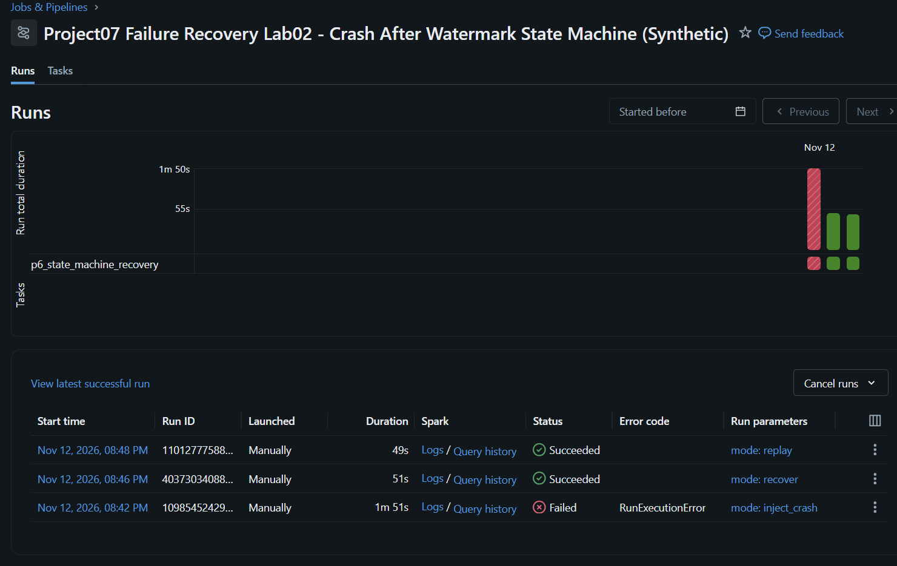

# Project 07 — Failure Recovery Lab 02: Watermark Committed, Audit Missing

**Verified on Databricks Serverless, 12 November 2026 (Thailand time).**
Only fabricated synthetic order data. This is a supervised reliability lab,
**not** a production outage, fully automated recovery system or multi-table
transaction.

## Business failure this project simulates

A pipeline performs a Delta MERGE, and then advances the Watermark.
Before it records the Batch Completion Audit, the notebook crashes.

A naive incremental loader could see the advanced Watermark and skip the
batch forever despite missing completion evidence. A naive full retry could
also duplicate orders or mistakenly overwrite corrected rows. The correct
approach is to reconcile target, Watermark and completion status separately.

## New isolated tables and event-sourced state machine

All writes are limited to new Delta tables under
workspace.project07_sandbox:

| Table | Purpose |
|---|---|
| p6_recovery_target | Synthetic clone of the Phase 5 target |
| p6_recovery_watermark | Independent monotonic checkpoint for this batch |
| p6_state_events | Append-only state transition events, grouped by attempt_id |
| p6_completion_audit | One idempotent Completion Audit per batch_id |

The event-sourced state machine records:
STARTED -> MERGED -> CHECKPOINTED -> FAILED (intentional failure),
or STARTED -> MERGED -> CHECKPOINTED -> COMPLETED (recovery/replay).

Each transition is checked against the preceding state of the SAME attempt.
The ledger has one event per transition and never erases earlier failures.
A normal replay may record its own COMPLETED transition but cannot create
a duplicate batch completion record.

Read only: Phase 5 target and historical Phase 3 Gold manifest. Original
Bronze, Silver, Phase 2–5 tables and approved Gold remain unchanged.

Code: [Notebook 16 — Recovery State Machine](../notebooks/16_p6_crash_after_watermark_state_machine_sandbox.py)

Unit tests: [P6 State Machine tests](../tests/test_p6_checkpoint_failure_state_machine.py)

Independent SQL: [P6 Acceptance SQL](../sql/10_p6_watermark_crash_recovery_verify.sql)

## Real Databricks execution

Job: **Project07 Failure Recovery Lab02 - Crash After Watermark State Machine
(Synthetic)**

Job ID: **801712658874292**

| Mode | Run ID | Actual result | Data MERGE | Batch completion rows |
|---|---|---|---|---:|
| inject_crash | 1098545242963842 | FAILED **as designed** | 3 inserts / 1 update | 0 |
| recover | 403730340887020 | SUCCESS | 0 inserts / 0 updates | 1 |
| replay | 1101277758854035 | SUCCESS | 0 inserts / 0 updates | 1 |

- [Expected failure run](https://dbc-381faf33-7320.cloud.databricks.com/?o=7474648569137518#job/801712658874292/run/1098545242963842)
- [Successful recovery](https://dbc-381faf33-7320.cloud.databricks.com/?o=7474648569137518#job/801712658874292/run/403730340887020)
- [Successful replay](https://dbc-381faf33-7320.cloud.databricks.com/?o=7474648569137518#job/801712658874292/run/1101277758854035)

### Genuine Databricks Job screenshot

The screenshot is captured from the authenticated Databricks UI. Account
identity was cropped out before publication. Red means an **expected**
fault-injection test, not an unresolved incident.

## Independent SQL evidence: after each stage

| Metric | After crash | After recovery | After replay |
|---|---|---|---|
| Data rows | 5,277 | 5,277 | 5,277 |
| Distinct composite keys | 5,277 | 5,277 | 5,277 |
| Total units | 13,200 | 13,200 | 13,200 |
| Synthetic source amount (all statuses) | 5,275,100.00 | 5,275,100.00 | 5,275,100.00 |
| Watermark | **2026-02-04** | 2026-02-04 | 2026-02-04 |
| Completion rows per Batch | **0** | **1** | **1** |
| Latest state | FAILED | COMPLETED | COMPLETED |
| Attempts represented in ledger | 1 | 2 | 3 |
| State transition event rows | 4 | 8 | 12 |
| Original approved Gold | p3_v2_valid | p3_v2_valid | p3_v2_valid |

Read-only SQL statement IDs:
- After failure: 01f1de9f-5095-1639-8219-927d87ed418f
- After recovery: 01f1de9f-9c0f-1e8b-8e23-c982313e2eec
- After replay: 01f1de9f-dc8f-1019-8a7d-8f632ea153f1

The SQL verifies event status transitions, 0 unsafe completed attempts and
that original Gold remains unchanged.

## Delta History confirms idempotency

Verified read-only transaction history statements:

- Target: 01f1dea0-12b3-1344-8850-3db1c5d5bdeb
- Watermark: 01f1dea0-142d-1cec-a3e3-cf4bc03932ba
- Completion audit: 01f1dea0-15a1-1bec-ab59-1046c77135c0

Target Delta MERGE history:

| MERGE | Insert | Update | Files added | Files removed |
|---|---:|---:|---:|---:|
| Crash-injection first committed MERGE | 3 | 1 | 4 | 0 |
| Recovery MERGE | **0** | **0** | **0** | **0** |
| Replay MERGE | **0** | **0** | **0** | **0** |

Checkpoint history contains seven MERGE attempts because the seed/check
operation occurs on each run and the platform retried the failed Job. Only
the initial seed inserted one checkpoint and the first true advance updated
it once; all remaining checkpoint MERGEs were data-file no-ops.

Completion Audit Delta history contains two MERGEs: recovery inserted one
completion row; replay inserted/updated zero rows and added/removed zero
data files. This is **per-batch idempotency**, not simply Task success.

[Machine-readable API + SQL verified report](evidence/p6_crash_after_watermark_state_machine_validated.json)

## Incident-response runbook

1. Open the failed Databricks Job run and distinguish the intentional marker
   P6_INJECTED_CRASH_AFTER_WATERMARK from an unrelated runtime error.
2. Query target rows and composite business-key uniqueness; verify the MERGE
   committed and totals match expected synthetic source.
3. Query Watermark. It is already at the new Batch timestamp, which **does
   not prove** the Completion Audit exists.
4. Query the completion table by batch_id, not by run_id. The missing row
   indicates the Batch is not yet marked complete.
5. Inspect p6_state_events: STARTED, MERGED, CHECKPOINTED, FAILED. Do not
   delete earlier failure records or reset the checkpoint.
6. Execute recover with the **same** batch_id. Read and reconcile committed
   target data despite a checkpoint that is already up to date.
7. Require guarded Delta MERGE to show zero inserts/updates and no new data
   files. Record one completion row via MERGE keyed on batch_id.
8. Append the COMPLETED state event; verify independent read-only SQL.
9. Execute replay with the same batch; require the completion table to remain
   exactly one row. Preserve original Gold.
10. Capture Job screenshot, SQL evidence, Delta History and the incident
    narrative in the portfolio.

## Tests, scope and limitations

- Portable automated Python unit/contract tests: **90/90 PASS** after Lab 02.
- The crash is intentionally raised AFTER two real Delta commits, not a loss
  of cluster/host power. The FAILED state is explicitly written before the
  exception; a real hard crash may instead leave CHECKPOINTED as latest
  status. Such incomplete states still require separate recovery testing.
- The event log, data table, checkpoint and completion audit are committed
  independently. **There is no multi-table ACID guarantee.**
- The same-batch recovery is **manual**, with no auto retry scheduler,
  external alert delivery or arbitrary incident self-repair claimed.
- Only a single deterministic batch and an ordered one-writer lab are
  exercised. Multiwriter fencing, general CDC ingest, schema migration
  handling and SLA monitoring are future work.
- All source amounts are synthetic order metrics, not recognized revenue.

**Suggested next milestone:** add incomplete-state recovery for a true
interruption before the FAILED event can be recorded; then enable safe
dynamic monitoring, reviewed alert destinations and controlled CI/CD.
