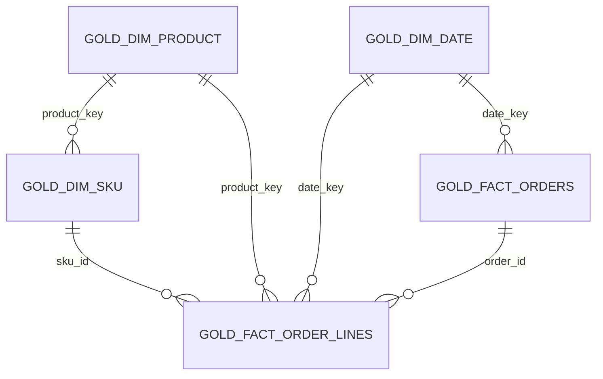

# Project 07 — Gold Star Schema (Phase 1)

This document describes the **synthetic-only** portfolio sandbox model.
It is not a claim of production deployment or validation of real customer data.

## Source and scope

- Databricks catalog + schema: `workspace.project07_sandbox`
- Synthetic CSV: 5,249 rows and 65 original columns
- Bronze: `workspace.project07_sandbox.bronze_orders`
- Silver: `workspace.project07_sandbox.silver_orders`
- Model implementation: `notebooks/08_gold_star_schema_sandbox.py`
- Validation tests: `tests/test_gold_star_schema_phase1.py`
- Existing historical `workspace.bronze`, `workspace.silver` and `workspace.gold` objects are out of scope.

## Business grain and dimensions

| Table | Business grain | Keys and measures |
|---|---|---|
| `gold_fact_order_lines` | One unique synthetic `order_id + sku_id` per row | SHA-256 `order_line_key`; `sku_id`, `product_key`, `date_key`; quantity; source_order_amount; completed_order_amount |
| `gold_fact_orders` | One unique synthetic `order_id` per row | order_id; date_key; order_status; line_count; total_units; source_order_amount; completed_order_amount |
| `gold_dim_sku` | One unique `sku_id` | sku_id; seller_sku; product_key; variation |
| `gold_dim_product` | One unique derived `product_key` | product_key (SHA-256 of normalized synthetic product_name); product_name; product_category |
| `gold_dim_date` | One calendar date | date_key (YYYYMMDD integer), calendar_date, year, quarter, month, day |

`product_key` is **fabricated/deterministically derived** because the
synthetic source does not have a canonical product_id. Do not represent it as
a real source system's product identifier.

## Star-schema relationships

**Important limitation:** The fabricated 5,249-row dataset has exactly
5,249 unique order IDs and 53 SKUs mapped one-to-one to 53 product names.
A real retailer can have multiple order lines per order and multiple SKUs
per product; these keys and mappings must be reassessed on real sources.

## Revenue and status semantics

Source `Order Amount` is positive even when `Order Status` is
`Cancelled` or `Processing`. It must NOT be labelled recognized revenue.

- `source_order_amount`: source measure across all order statuses.
- `completed_order_amount`: source measure only when status is `Completed`,
  otherwise 0. This is **not** proof of cash received, accounting revenue,
  refunds settled or net sales.
- `total_units`: sum of quantity across all statuses; not necessarily units
  shipped or realized sales.

## QA contract before Gold writes

1. Synthetic source marker and synthetic order-id prefix.
2. Expected 5,249 rows in both Bronze and Silver.
3. Uniqueness of Order ID + SKU ID and no multiplied/missing join rows.
4. Required product, seller SKU and parseable created timestamp.
5. One consistent product mapping per SKU and one status/date per order.
6. No orphan `sku_id`, `product_key` or `date_key` in facts.
7. Unit totals and source amount totals match Silver -> fact lines -> fact orders.
8. Five new Gold tables written only under `workspace.project07_sandbox`.

## Operational limitations before Phase 2

- Overwrite is still used **only** for the dedicated sandbox Gold tables.
- Multiple Gold table writes are **not atomic as a group**. A partial job
  failure can leave mixed generations. The next Phase will introduce a
  batch/run ID, versioned staging, publish manifest and controlled promotion.
- Incremental MERGE / CDC / SCD2 have not yet been integrated into this
  newly QA-gated dimensional workflow.
- No production secrets or raw customer records should be committed.
- Use real screenshots and run IDs as evidence; sanitize credentials and PII.

## Acceptance checks

- New tables: 5
- Expected fact order lines: 5,249
- Expected fact orders: 5,249
- Expected SKU dimension: 53
- Expected product dimension: 53
- Expected calendar dates: 5
- Expected total units: 13,122
- Expected total source order amount: 5,246,000.00 (synthetic currency units)
