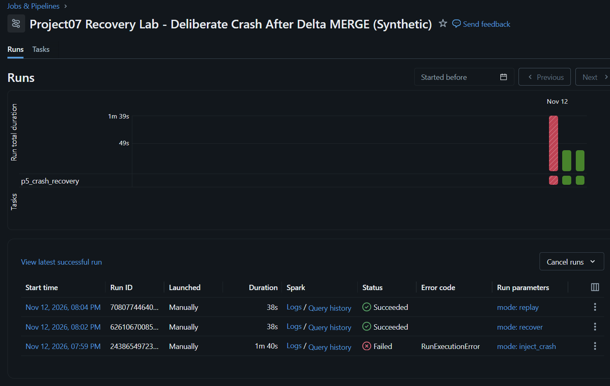

# Project 07 — Failure Recovery Lab: Crash After a Committed Delta MERGE

**Verified on Databricks Serverless, 12 November 2026 (Thailand time).**
This is a synthetic portfolio exercise, NOT a company production incident.

## Business problem

A pipeline can finish its Delta MERGE transaction but crash BEFORE recording
its Watermark and completion Audit. A naive retry could duplicate records,
overwrite corrections or misreport the batch status.

This lab deliberately creates that failure, inspects the persisted data and
then retries the EXACT SAME batch safely.

## Scope and safety

All writes are strictly isolated to three NEW Delta tables in the
workspace.project07_sandbox schema:

| Table | Purpose |
|---|---|
| p5_recovery_target | Independent synthetic clone of Phase 2 order-line data |
| p5_recovery_watermark | Separate checkpoint for this recovery lab |
| p5_recovery_audit | Append-only completion audit attempts |

Read-only: Phase 2 p2_incremental_order_lines and Phase 3 p3_publish_manifest.
Original Bronze, Silver, Gold, P2 and P3 were not changed.

Code: [15_p5_crash_after_merge_recovery_sandbox.py](../notebooks/15_p5_crash_after_merge_recovery_sandbox.py)

Local tests: [test_p5_crash_recovery.py](../tests/test_p5_crash_recovery.py)

Read-only SQL: [09_p5_crash_recovery_state_verify.sql](../sql/09_p5_crash_recovery_state_verify.sql)

Databricks Job ID: **396564470358773**

## Live Databricks execution

| Mode | Job Run ID | Actual status | MERGE data mutations |
|---|---|---|---|
| inject_crash | 243865497238959 | FAILED intentionally | 5 inserted, 2 updated |
| recover | 626106700853988 | SUCCESS | 0 inserted, 0 updated |
| replay | 708077446402884 | SUCCESS | 0 inserted, 0 updated |

- [Intentional failed run](https://dbc-381faf33-7320.cloud.databricks.com/?o=7474648569137518#job/396564470358773/run/243865497238959)
- [Recovery success](https://dbc-381faf33-7320.cloud.databricks.com/?o=7474648569137518#job/396564470358773/run/626106700853988)
- [Replay success](https://dbc-381faf33-7320.cloud.databricks.com/?o=7474648569137518#job/396564470358773/run/708077446402884)

### Real screenshot from Databricks

Actual connected Databricks browser screenshot, cropped to exclude account
identity. Red signifies a controlled failure test, not a broken project.

## Reconciliation at three checkpoints

| Metric | After crash | After recovery | After replay |
|---|---:|---:|---:|
| Synthetic rows in P5 target | 5,274 | 5,274 | 5,274 |
| Distinct composite keys | 5,274 | 5,274 | 5,274 |
| Units | 13,192 | 13,192 | 13,192 |
| Source order amount | 5,270,890.00 | 5,270,890.00 | 5,270,890.00 |
| Batch rows already applied | 7 | 7 | 7 |
| Watermark source date | Feb 2, 2026 | Feb 3, 2026 | Feb 3, 2026 |
| Completed recovery/replay audits | **0** | **1** | **2** |
| Original Gold active snapshot | p3_v2_valid | p3_v2_valid | p3_v2_valid |

SQL statement IDs, independently executed through Databricks SQL Warehouse:

- After crash: 01f1de99-31fa-1c70-8348-d66165e0da37
- After recovery: 01f1de99-7af2-144f-abe3-b885f2303d4a
- After replay: 01f1de99-b0c2-1e52-9e13-2c7fd3d4eeea

Amounts are synthetic source-order values across all order statuses, NOT
recognized revenue.

### Delta transaction history — independent proof of no mutations

History SQL Statement: 01f1de99-c9de-13c8-96cc-2b491a23e957

| Delta version | MERGE phase | Insert | Update | Data files added | Data files removed |
|---|---|---:|---:|---:|---:|
| 1 | Injected crash (committed data) | 5 | 2 | 6 | 0 |
| 2 | Recovery | **0** | **0** | **0** | **0** |
| 3 | Replay | **0** | **0** | **0** | **0** |

The no-op runs still appear as new Delta history versions, but changed zero
business rows and wrote no data files.

See [machine-readable verified API and SQL evidence](evidence/p5_crash_after_merge_recovery_validated.json).

## Diagnosing the unexpected automatic second attempt

The failed Job contained two Task attempts. The FIRST actually completed its
Delta MERGE, then raised a deliberate RuntimeError with marker
P5_INJECTED_CRASH_AFTER_MERGE.

Databricks attempted the Task again. The SECOND attempt detected that the
target was no longer pristine and refused another injection:
P5_INJECTION_REFUSED.

This is a meaningful reliability safeguard: Job failure does NOT mean a
previous Delta transaction was rolled back.

## Incident response runbook

1. Identify the failed Databricks Run ID and exact Task/error marker.
2. Inspect target row count, composite-key uniqueness, unit total and amount.
3. Inspect Watermark and completion Audit separately; never assume they
   advanced together with a successful Delta MERGE.
4. Check Delta DESCRIBE HISTORY for committed inserts/updates and file writes.
5. Retry with the SAME batch ID using mode=recover; do not reset the target.
6. Confirm that the guarded MERGE has **0 inserts, 0 updates**.
7. Verify Watermark advancement and write a completion Audit entry.
8. Execute read-only SQL acceptance; ensure original approved Gold is unchanged.
9. Retry once more using mode=replay to demonstrate no duplication or data
   rewrite. Capture Job statuses and Delta history.
10. In a real company, notify the on-call owner and record a root-cause
    review. The lab does not claim automatic on-call alerts.

## Verification and limits

- Automated Python tests: **76/76 PASS** locally (10 new recovery contracts).
- A real Delta transaction committed; the crash was an intentionally raised
  exception, not actual compute termination or a company outage.
- The failure point covered is AFTER target MERGE and BEFORE checkpoint/Audit.
  Other crash windows still need dedicated tests.
- Delta MERGE is atomic for its target table. The target, Watermark and Audit
  are **not a single multi-table ACID transaction**.
- Recovery was manually triggered. No automatic repair scheduler, live CDC
  feed, real payment/Ads/customer data, alert delivery, or 24/7 SLA is claimed.

**Next exercise:** crash AFTER Watermark but BEFORE Audit, plus a durable
per-batch state machine and automatic safe retries.
