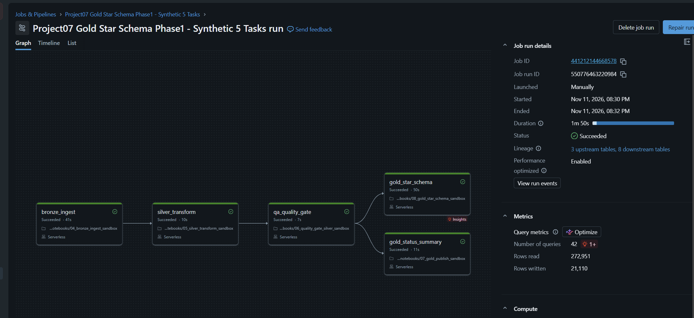
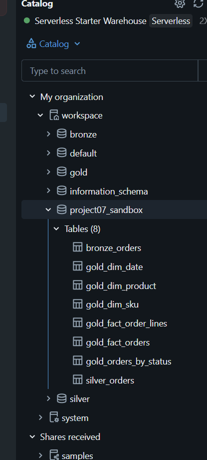

# Project 07 — Phase 1 Gold Star Schema: Verified Results

Verification date: 2026-11-11 (Asia/Bangkok)
Scope: Databricks Free Edition, serverless, **fabricated source data only**.
Changes: **five new managed Delta tables in the existing private sandbox schema**.
Historical `workspace.bronze`, `workspace.silver`, `workspace.gold`
and real Orders/Products Workshop source files were not modified.

## 1. Job execution (real Databricks run)

- Job: `Project07 Gold Star Schema Phase1 - Synthetic 5 Tasks`
- Job ID: `441212144668578`
- Run ID: `550776463220984`
- Job state: `TERMINATED / SUCCESS`
- Duration: `110944 ms` (110.9 sec)
- Tasks: `bronze_ingest`, `silver_transform`, `qa_quality_gate`,
  `gold_status_summary`, `gold_star_schema` — **5/5 SUCCESS**.
- Gold outputs are downstream of the QA Gate.
- Existing four-task Job remains unmodified.

[Open Databricks five-task run (requires login)](https://dbc-381faf33-7320.cloud.databricks.com/?o=7474648569137518#job/441212144668578/run/550776463220984)

## 2. Five new Gold tables

| Table | Verified row count |
|---|---:|
| `workspace.project07_sandbox.gold_fact_order_lines` | 5,249 |
| `workspace.project07_sandbox.gold_fact_orders` | 5,249 |
| `workspace.project07_sandbox.gold_dim_sku` | 53 |
| `workspace.project07_sandbox.gold_dim_product` | 53 |
| `workspace.project07_sandbox.gold_dim_date` | 5 |

## 3. Independent read-only SQL reconciliation

- SQL source: `sql/04_gold_star_schema_reconciliation.sql`
- Databricks Statement ID: `01f1ddd4-bae5-19d8-93cd-6ed2be94f3b4`
- SQL Statement API status: `SUCCEEDED`
- Machine-readable verified output:
  `docs/evidence/phase1_gold_schema_reconciliation_result.json`

| Metric | Observed result |
|---|---:|
| Fact line rows | 5,249 |
| Fact order rows | 5,249 |
| Dimension SKU rows | 53 |
| Dimension product rows | 53 |
| Dimension date rows | 5 |
| Sum(quantity) | 13,122 |
| Fact lines source order amount | 5,246,000.00 |
| Fact orders source order amount | 5,246,000.00 |
| Missing SKU references | 0 |
| Missing product references | 0 |
| Missing date references | 0 |
| Missing order references | 0 |

**Do not present `source_order_amount` as realized revenue:** the fabricated
dataset contains positive amounts even for Cancelled and Processing orders.

## 4. QA / safety

- Local Python automated suite: **38/38 PASS**.
- New notebook: `notebooks/08_gold_star_schema_sandbox.py`
- New tests: `tests/test_gold_star_schema_phase1.py`
- Documentation: `docs/PROJECT07_GOLD_STAR_SCHEMA_DESIGN.md`
- Pre-write checks: Join multiplication, row counts, SKU mapping, product
  mapping, date parsing, order grain, FK presence, units and amounts.
- All new table writes guarded by prefix `workspace.project07_sandbox`.
- Screenshot of live Databricks run saved and reviewed; Catalog crop omits
  account/email owner details. Original full-screen captures are
  stored privately at:
  `Desktop/Workshop/Project-07-Databricks-Lakehouse/04-Private-Evidence/`
  and must **not** be committed or published.

## 5. Outstanding engineering work

- This Gold build still overwrites **sandbox-exclusive** tables on every
  successful execution and is not an incremental production pipeline.
- The five Gold table writes are not atomic as a group. On a partial
  failure, inconsistent generations are possible.
- A failed future run skips new Gold execution but does not automatically
  invalidate the previously published Gold snapshot.
- Production-like incremental MERGE, batch id, versioned publish,
  watermark, SLA metrics, alerting and CI/CD remain future phases.
- Synthetic business assumptions must be rechecked for real ERP/marketplace
  data (a real Order may have multiple lines, a real Product multiple SKUs).

## 6. Repository publication status

Local development branch: `feature/project07-portfolio-upgrade`.
No Git commit, push, PR merge, Portfolio website deployment, or public data
release was performed during this Phase.
