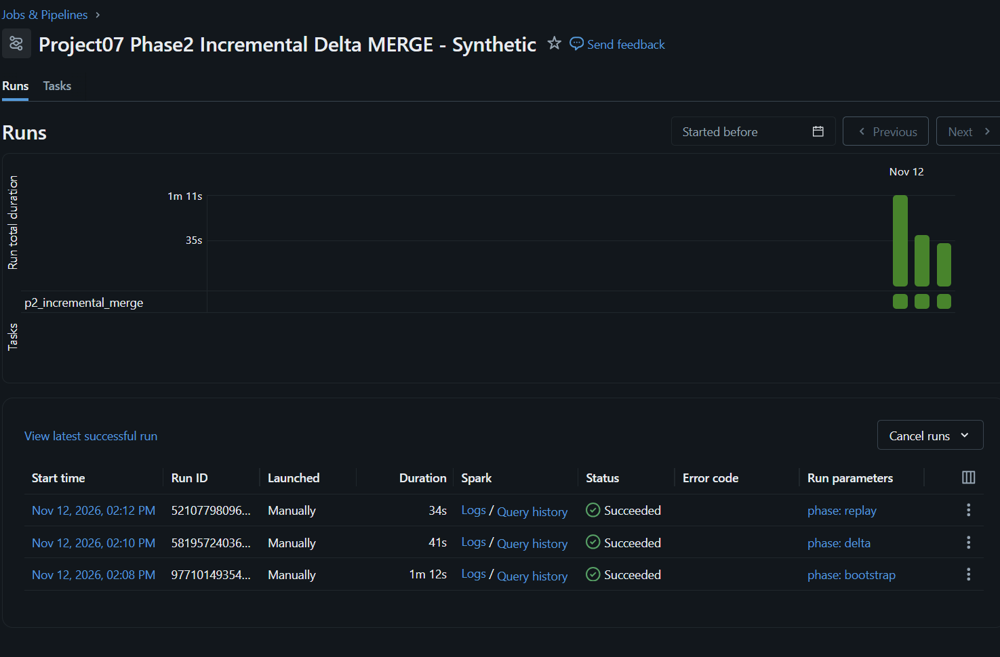

# Project 07 — Phase 2: Live Incremental MERGE and Idempotency Evidence

Verified 12 November 2026 (Thailand). Genuine Databricks Serverless Jobs using **fabricated, deterministic orders** in an isolated portfolio sandbox. **Not a company production deployment.**

## Architecture and scope

Read-only source: workspace.project07_sandbox.silver_orders (5,249 rows).

Phase 2 writes only these **new, isolated** managed Delta tables:

| Table | Purpose |
|---|---|
| workspace.project07_sandbox.p2_incremental_order_lines | Current synthetic order-line state; business key (order_id, sku_id) |
| workspace.project07_sandbox.p2_watermark | Last successfully processed source timestamp, one row per pipeline |
| workspace.project07_sandbox.p2_batch_audit | Append-only record of successful bootstrap, delta and replay attempts |

- Notebook: [09_incremental_merge_sandbox.py](../notebooks/09_incremental_merge_sandbox.py)
- Tests: [test_phase2_incremental_merge.py](../tests/test_phase2_incremental_merge.py)
- Read-only SQL: [05_phase2_incremental_verification.sql](../sql/05_phase2_incremental_verification.sql)
- Job: Project07 Phase2 Incremental Delta MERGE - Synthetic
- Job ID: 631624372226366
- Job parameter: phase = bootstrap, delta or replay

## Actual Databricks executions

| Phase | Run ID | Job result | Incoming | Inserted | Updated | Unchanged |
|---|---|---|---:|---:|---:|---:|
| Bootstrap | 977101493545830 | SUCCESS | 5,249 | 5,249 | 0 | 0 |
| Delta | 581957240360086 | SUCCESS | 23 | 20 | 3 | 0 |
| Replay | 521077980962748 | SUCCESS | 23 | **0** | **0** | **23** |

- [Bootstrap run](https://dbc-381faf33-7320.cloud.databricks.com/?o=7474648569137518#job/631624372226366/run/977101493545830)
- [Delta run](https://dbc-381faf33-7320.cloud.databricks.com/?o=7474648569137518#job/631624372226366/run/581957240360086)
- [Replay run](https://dbc-381faf33-7320.cloud.databricks.com/?o=7474648569137518#job/631624372226366/run/521077980962748)

### Screenshot proof

Screenshot source: captured from the connected authorized Opera Databricks tab; cropped to exclude user/account identity. Not an illustration or reconstruction.

## Independent SQL reconciliation

Read-only SQL Statement ID: 01f1de68-81ad-11c2-87e8-18ee21032fd0.

| Metric | Verified |
|---|---:|
| Order-line target rows | 5,269 |
| Distinct (order_id, sku_id) keys | 5,269 |
| Total quantity | 13,175 |
| Source order amount, all statuses | 5,265,850.00 |
| Watermark rows | 1 |
| Last source timestamp processed | 2026-02-02 00:00:00 UTC |

**Important:** The amount is synthetic and includes all order statuses; it is not realized or recognized revenue.

Actual SQL API rows and run statuses are preserved in [machine-readable validated results](evidence/phase2_incremental_merge_validated.json).

## Independent Delta transaction-history proof

Read-only DESCRIBE HISTORY Statement ID: 01f1de68-cf23-1458-af9e-1d05da7d4a73.

| Delta version | MERGE stage | Source rows | Inserted | Updated | Files added | Files removed |
|---|---|---:|---:|---:|---:|---:|
| 1 | Bootstrap | 5,249 | 5,249 | 0 | 1 | 0 |
| 2 | Delta | 23 | 20 | 3 | 5 | 0 |
| 3 | Replay | 23 | **0** | **0** | **0** | **0** |

Replay is verified to be a **data-level no-op** by Delta operation metrics. Running it still creates a new Delta transaction-history version.

## QA rules and code verification

- Incoming business keys must be unique, non-null; quantity positive; amount nonnegative.
- Original Silver source must be the same 5,249-line synthetic dataset.
- Order IDs must have SYN-ORDER- prefix; no private files read.
- Existing rows update only when the source timestamp is newer AND row content hash differs.
- A stale batch with a source timestamp lower than the saved watermark is rejected.
- MERGE target row counts and key uniqueness are reconciled after the write.
- Replayed batch must have zero inserts, zero updates and 23 unchanged.
- Local Python automated tests: **45/45 PASS**.
- Phase 1 Bronze, Silver, Gold and all historical production-like tables remain untouched.

## Limitations and next development phase

1. Source changes are fabricated deterministic batches, not an actual CDC connector, ERP feed, API stream or new file arrival.
2. MERGE is atomic for the target Delta table only. Target, watermark and batch audit are NOT a single cross-table transaction; interruption between writes needs recovery logic.
3. Source size, schema and expected row counts are fixed for this reproducible training lab.
4. The Job has no automatic schedule, on-call alerts, concurrency stress testing or SLA promise.
5. Versioned Gold promotion, late-arriving records, source schema drift and rejected-record handling are pending.
6. No real customer files, accounts or credentials have been published.

Recommended next steps: controlled failure/recovery, robust audit state transitions, batch-safe Gold publish, monitoring and GitHub deployment automation.
