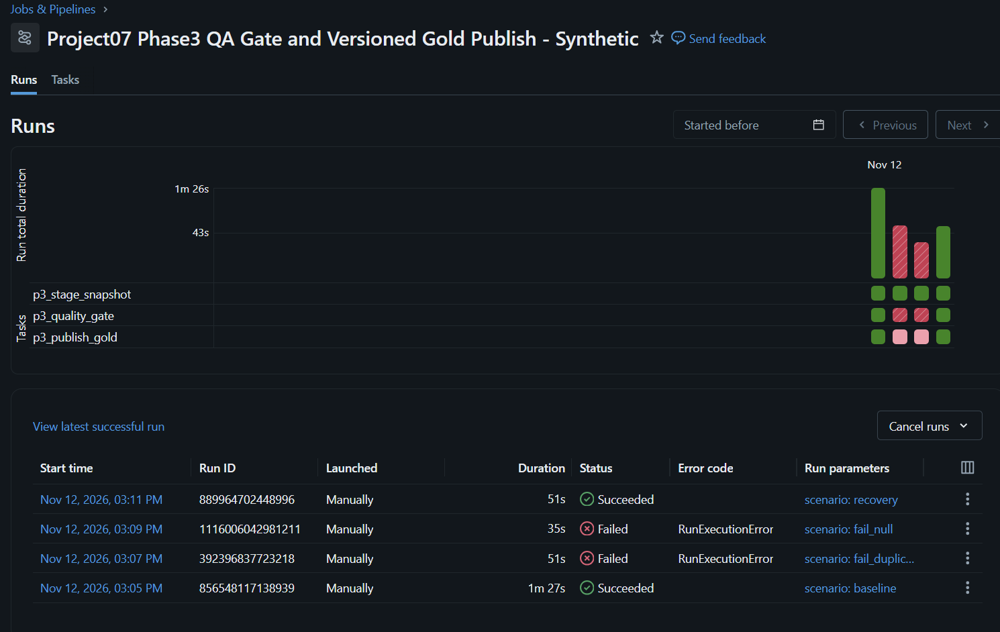
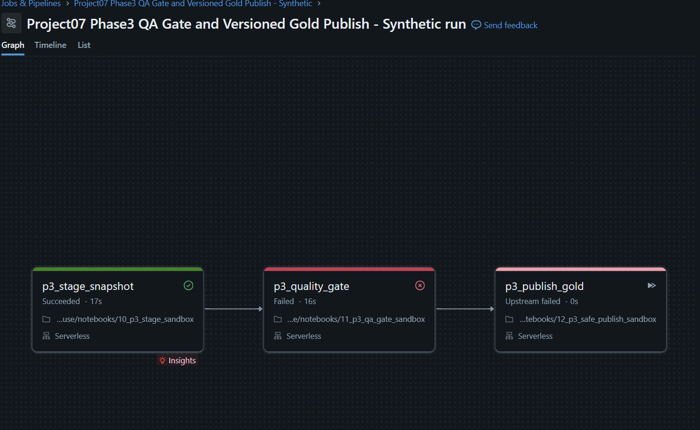
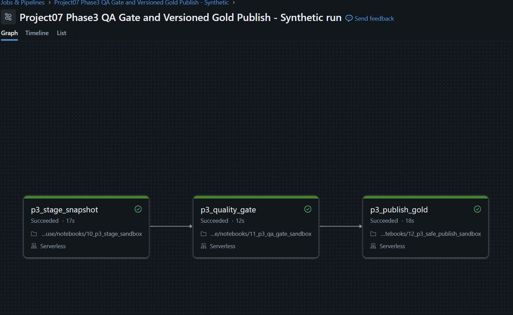

# Project 07 — Phase 3: QA Failure Injection, Recovery and Versioned Gold Publishing

Verified on 12 November 2026 (Thailand time).
This is a real Databricks Serverless workflow using fabricated synthetic
orders in a portfolio sandbox, **not company production data**.

## Problem and solution

An incoming bad batch must not replace the previously trusted Gold data.
Phase 3 creates immutable versioned snapshots, checks Data Quality, and
only switches the published snapshot through a single Delta manifest pointer
after QA PASS. This does not provide a cross-table ACID transaction.

## Pipeline architecture

Three Databricks tasks with dependencies:

1. Stage: [10_p3_stage_sandbox.py](../notebooks/10_p3_stage_sandbox.py)
   - Read only from workspace.project07_sandbox.p2_incremental_order_lines
   - Append a separate immutable, synthetic snapshot for each scenario
2. QA: [11_p3_qa_gate_sandbox.py](../notebooks/11_p3_qa_gate_sandbox.py)
   - Detect duplicated business keys, NULL, bad measures/statuses, orphan
     SKUs, missing required columns, unexpected counts and totals
   - Write a QA audit and quarantined rejection records
   - Raise a real error on QA FAIL so the downstream Publish task is skipped
3. Publish: [12_p3_safe_publish_sandbox.py](../notebooks/12_p3_safe_publish_sandbox.py)
   - Require a successful QA result and verify the snapshot again
   - Atomically update the active version in one Delta manifest table
   - Give readers a View of the latest QA-approved snapshot
   - Prevent regression to an older snapshot version

New tables and view under workspace.project07_sandbox:

| Object | Purpose |
|---|---|
| p3_snapshot_lines | Immutable synthetic order-line versions, good and bad |
| p3_quality_audit | Per-attempt QA checks and PASS/FAIL |
| p3_rejected_rows | Quarantined synthetic errors and reason codes |
| p3_publish_manifest | One active snapshot pointer and approved metrics |
| p3_publish_audit | Successful publication attempts |
| p3_current_gold_order_lines | View filtered to active published version |

No Phase 1 Gold, historical workspace.gold, or customer-data tables were changed.

## Real Databricks run evidence

Job ID: 824168112776513

| Scenario | Run ID | Job result | Stage | QA | Gold Publish |
|---|---|---|---|---|---|
| Baseline v1 | 856548117138939 | SUCCESS | PASS | PASS | PASS |
| Duplicate injection | 392396837723218 | FAILED (expected) | PASS | FAIL | SKIPPED |
| NULL injection | 1116006042981211 | FAILED (expected) | PASS | FAIL | SKIPPED |
| Clean recovery v2 | 889964702448996 | SUCCESS | PASS | PASS | PASS |

- [Baseline run](https://dbc-381faf33-7320.cloud.databricks.com/?o=7474648569137518#job/824168112776513/run/856548117138939)
- [Duplicate-key failure](https://dbc-381faf33-7320.cloud.databricks.com/?o=7474648569137518#job/824168112776513/run/392396837723218)
- [NULL-value failure](https://dbc-381faf33-7320.cloud.databricks.com/?o=7474648569137518#job/824168112776513/run/1116006042981211)
- [Recovery success](https://dbc-381faf33-7320.cloud.databricks.com/?o=7474648569137518#job/824168112776513/run/889964702448996)

## Genuine evidence images

These images were captured from the connected authorized Databricks tab and
cropped to omit account identity; they are not fabricated illustrations.
The RED outcomes are intentional and correctly rejected by QA.

## Independent SQL acceptance checks

Before failure testing, baseline successfully published snapshot p3_v1.
After EACH intentional failure, SQL independently confirmed that visible
Gold and the active pointer remained unchanged:

- Active: p3_v1, version 1
- Visible rows and distinct business keys: 5,269 / 5,269
- Sum quantity: 13,175
- Source order amount (all statuses): 5,265,850.00

After clean recovery:

- Active: p3_v2_valid, version 2
- Visible rows and distinct business keys: 5,269 / 5,269
- Sum quantity: 13,176
- Source order amount (all statuses): 5,265,860.00
- QA audit PASS attempts: 2
- QA audit FAIL attempts: 3 (the duplicate QA task had two attempts)
- Quarantined rejection entries: 3
- Successful Gold publications: 2

Note: The extra QA FAIL attempt is a retry of the same duplicate-key test,
not an additional unique incident. Amounts are fabricated source measures,
NOT realized revenue.

Read-only SQL statement IDs:
- After duplicate failure: 01f1de70-622c-1dc6-9c62-44b6ff9de310
- After NULL failure: 01f1de70-9c35-1d54-b348-8f9ab29b37d4
- After clean recovery: 01f1de70-db23-1ff9-95d3-c01a0bc9d9d5

SQL: [07_phase3_safe_publish_verify.sql](../sql/07_phase3_safe_publish_verify.sql)

Validated machine-readable result:
[phase3_qa_recovery_publish_validated.json](evidence/phase3_qa_recovery_publish_validated.json)

## Verification, boundaries and next engineering work

- Automated Python contract/unit tests: **55/55 PASS** locally before deployment.
- Phase 3 reads only the Phase 2 synthetic dataset and writes new p3_* tables.
- Versioned immutable snapshots and one-row Delta manifest pointer allow a
  controlled promotion for this order-line model, not an atomic transaction
  spanning every fact, dimension, watermark and audit table.
- Snapshot staging, QA audit, rejection logs and publication audit are
  separate operations. Recovery from a crash between those writes and
  multiwriter concurrency is not yet production-hardened.
- Required-column checking is not full Schema Evolution compatibility QA.
- Real customer data, payment files, advertising files, production CDC,
  scheduling, alerts, on-call support and SLA performance are not claimed.
- The next Phase should add Monitoring/Alerting, automated recovery drills,
  retry policies, operational runbooks, SLA/latency reporting and CI/CD.

Portfolio demonstrations: real Databricks Jobs, QA Gates, duplicate/NULL
Failure Labs, prevented bad Gold release, QA-approved recovery, audit trail,
and reviewed screenshots.
