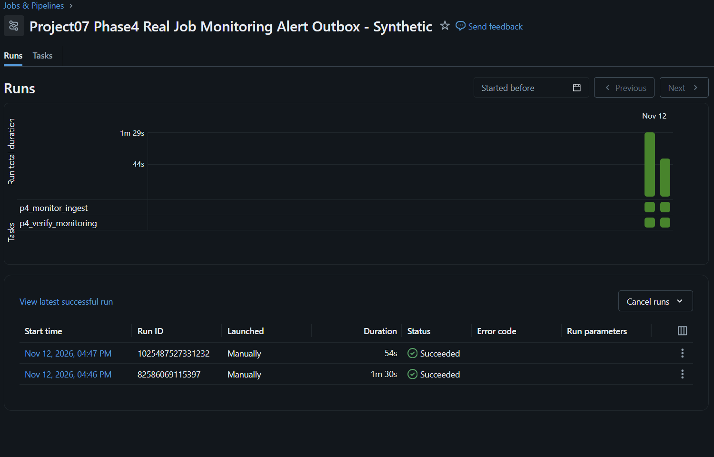

# Project 07 — Phase 4: Job Monitoring, Alert Outbox and Incident Recovery

Verified **12 November 2026** on Databricks Serverless using **synthetic**
e-commerce data and real Databricks Jobs API execution metadata.

This is a **portfolio lab**, not company production monitoring.
Internal Alert Outbox records have **not been delivered** to any external
email, Slack, LINE or webhook.

## Business responsibility

A Data Engineer needs to know which Job and Task failed, processing duration,
rows processed, whether QA blocked unsafe Gold, which incident recovered, and
whether a retry generates the same alert twice.

## Implemented architecture

1. Local CLI collector: [p4_collect_job_runs.py](../src/p4_collect_job_runs.py).
   Uses the authenticated Jobs API, fetches four completed real Phase 3 runs
   and only exports allowlisted metadata: run ID, start/end timestamp, duration,
   state, failed Task and attempts. No creator email or raw stack trace.
2. Synthetic-safe metadata file (under locally git-ignored data directory)
   uploaded to dedicated Unity Catalog Volume source area.
3. [13_p4_monitor_ingest_sandbox.py](../notebooks/13_p4_monitor_ingest_sandbox.py)
   ingests the sanitized API events, joins actual rows from Phase 3 QA audit,
   performs idempotent Delta MERGE of Job metrics, creates deduplicated alerts,
   and records verified incident recovery.
4. [14_p4_monitor_acceptance_sandbox.py](../notebooks/14_p4_monitor_acceptance_sandbox.py)
   is read-only and checks all important counts and active Gold snapshot.
5. [08_phase4_monitoring_acceptance.sql](../sql/08_phase4_monitoring_acceptance.sql)
   is a separate read-only SQL reconciliation executed on Databricks Warehouse.

Real Phase 4 Job ID: **632149905978914**.

New dedicated Delta tables under workspace.project07_sandbox:

| Table | Business grain / purpose |
|---|---|
| p4_run_metrics | one record per real Jobs API run ID |
| p4_alert_outbox | one record per unique alert key |
| p4_incident_state | one record per failed Job run |
| p4_monitor_audit | one row per monitoring execution / QA acceptance |

The metrics MERGE matches by run_id and compares an event-content hash.
The alert MERGE matches alert_key. Running the same API snapshot again does
not create duplicate operational metrics or alerts.

Alert rule: JOB_FAILED => HIGH. Run duration of at least 70,000 ms =>
DURATION_WARNING. All alert delivery statuses are NOT_CONFIGURED.

## Verified real data (real platform events; synthetic source orders)

| Phase 3 scenario | Real Run ID | Status | Duration | Rows observed from QA |
|---|---|---|---:|---:|
| Baseline | 856548117138939 | SUCCESS | 86,658 ms | 5,269 |
| Duplicate-key injection | 392396837723218 | FAILED as designed | 50,979 ms | 5,270 |
| Required-NULL injection | 1116006042981211 | FAILED as designed | 34,785 ms | 5,269 |
| Recovery | 889964702448996 | SUCCESS | 50,018 ms | 5,269 |

Duration/task status is from Jobs API. Row counts are from QA Audit,
not computed from an estimate.

Two actual Phase 4 monitoring executions:

| Monitoring Run | Run ID | Result |
|---|---|---|
| Initial | 82586069115397 | SUCCESS |
| Idempotent replay | 1025487527331232 | SUCCESS |

[Initial run](https://dbc-381faf33-7320.cloud.databricks.com/?o=7474648569137518#job/632149905978914/run/82586069115397)

[Monitoring replay run](https://dbc-381faf33-7320.cloud.databricks.com/?o=7474648569137518#job/632149905978914/run/1025487527331232)

### Genuine screenshot

Captured from the connected Databricks browser tab and cropped to exclude
account identity. Not a fabricated graphic or reconstruction.

### Independently verified SQL results

Statement ID: **01f1de7e-a647-173d-834c-c0ecaee332cc**.

| Metric | Verified |
|---|---:|
| Distinct monitored runs | 4 |
| Job runs SUCCESS / FAILED | 2 / 2 |
| Duration warnings (70-second threshold) | 1 |
| Processed rows over four runs | 21,077 |
| Maximum source Run duration | 86,658 ms |
| Failed-Job alerts | 2 |
| Slow-Job alerts | 1 |
| Total alerts | 3 |
| Distinct alert keys after replay | **3** |
| Undelivered alerts | **3** |
| Recorded incidents / recovered | 2 / 2 |
| Open incidents in this fixed lab | 0 |
| Monitoring executions / PASS | 2 / 2 |
| Active approved Gold | p3_v2_valid |
| Gold rows / units | 5,269 / 13,176 |

The SQL result and each real Job run are preserved in a validated
[machine-readable evidence file](evidence/phase4_monitoring_alert_replay_validated.json).

## Incident response runbook

### Duplicate business keys

1. Find the failed Job and Task via p4_run_metrics and JOB_FAILED alert.
2. Read p3_quality_audit and p3_rejected_rows for duplicates.
3. Confirm p3_publish_manifest still points to the approved Gold snapshot.
4. Correct the synthetic input and stage a **new** version without editing
   the old incident snapshot or forcibly overwriting Gold.
5. Re-run QA. Publish only after QA PASS.
6. Reconcile row counts and source-order amounts. Link recovery Run ID to
   the original failed incident.

### NULL required Order ID

1. Find error P3_QA_GATE_REJECTED and MISSING_REQUIRED_VALUE.
2. Diagnose upstream source/schema/required-value contract.
3. Keep the previous Gold available; do not silently drop invalid rows.
4. Create a valid replacement snapshot; require Stage > QA > Publish PASS.
5. Verify monitoring replay produces no duplicate alerts.

### Monitor itself is not healthy

1. Check CLI exit code, authentication and API health locally without
   logging access tokens.
2. Check the source snapshot freshness. Refuse stale data instead of
   presenting it as new events.
3. Restore source access, collect completed Jobs again, and rerun the
   idempotent monitor.
4. Mark recovery only after source and Gold reconciliation pass.

## Important limitations — do not oversell in interviews

- Phase 4 ingests a **fixed historical snapshot of four real runs**, not an
  automatically scheduled, continuously paginated live Jobs API feed.
- Monitoring was run manually; no 24-hour schedule is enabled.
- Alerts are stored in Delta but external delivery was **not configured**,
  so this is evidence of alert evaluation and deduplication, not sending.
- Incident resolution links historical errors to a verified later recovery
  in this controlled lab; it is not an automatic root-cause repair engine.
- No measured production SLA, escalation to on-call, live retry budget,
  external CDC connector or real customer/financial data.
- Gold source amounts use fabricated all-status values, not recognized revenue.

## Next operational milestone

Implement a paginated latest-run collector and explicit freshness watermark,
enable scheduling with a safe polling interval, set alert recipient(s) after
explicit approval, and test real delivery/acknowledgement with a staged
incident. Databricks has built-in Job failure and duration notifications:
https://docs.databricks.com/aws/en/jobs/notifications

**Portable automated suite after Phase 4:** 66/66 PASS (including new
observability tests), with GitHub CI to be verified when merged.
